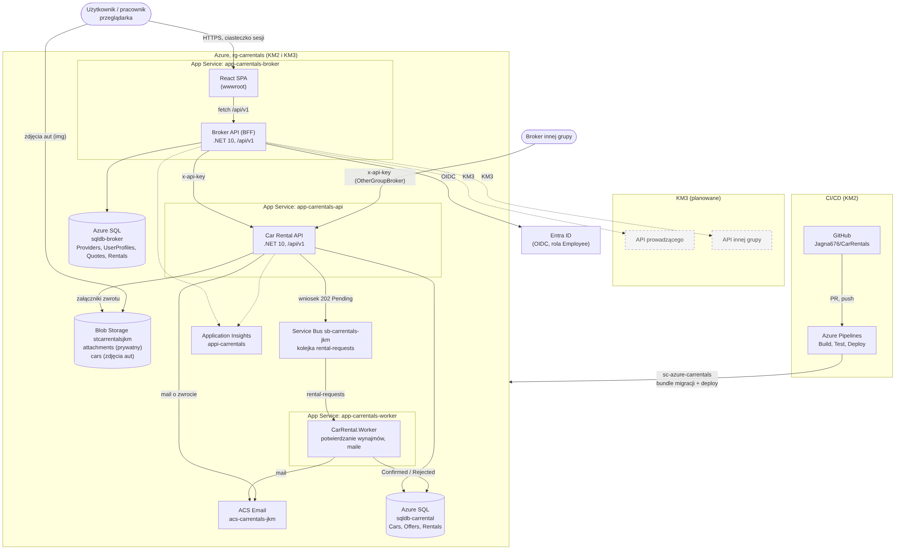
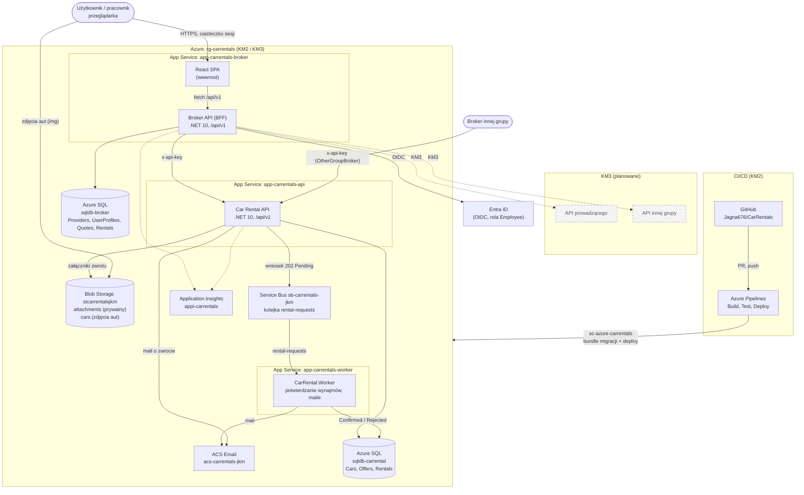

# Architektura (KM2 19.11.2026, usługi Azure z KM3)

Aktualny diagram komponentów. Linie ciągłe to to, co jest w kodzie (KM2 i usługi Azure z KM3), przerywane (szare pola "KM3") jeszcze czekają. Część "Azure" zacznie działać po pierwszym deployu (czeka na subskrypcję i service connection), do tego czasu to samo uruchamiamy lokalnie w docker compose. Źródło diagramu: `docs/diagrams/architecture.mmd`, obrazek: `docs/diagrams/architecture.png` (`mmdc -i architecture.mmd -o architecture.png`).

## Co jest na KM2

- React (Vite + TypeScript) serwowany przez Broker API z `wwwroot`. Jedna domena, więc ciasteczko sesji Brokera jest first-party (decyzja 1 w decisions-risks-km2.md). Lokalnie Vite na 5173 z proxy `/api` do Brokera.
- Broker API (BFF): logowanie (Entra ID przez OIDC, lokalnie dev-login), profil, katalog z cache, wycena z limitem 15 s, proxy panelu pracownika. Woła nasze Car Rental API przez HTTP z kluczem `x-api-key` (broker OurBroker).
- Car Rental API: katalog, oferty, wynajmy (202 Pending, potwierdzenie w tle po około 10 s), zwroty, panel pracownika z rolą Employee. Broker innej grupy łączy się swoim kluczem (OtherGroupBroker) i widzi tylko swoje dane.
- Dwie bazy Azure SQL (Basic): sqldb-carrental i sqldb-broker. Schemat z migracji EF, aktualizowany przez pipeline (EF migrations bundle) przed wdrożeniem kodu. Migracje generuje Maks skryptem `scripts/add-migrations.ps1`, lokalnie te same bazy są w docker compose.
- Application Insights: Car Rental API wysyła requesty, zależności i logi audytu (bez kluczy i z maskowaniem danych osobowych), gdy jest ustawione `APPLICATIONINSIGHTS_CONNECTION_STRING`. Broker tak samo (`UseAzureMonitor`, audyt przez zwykły log). Korelację wywołań Broker do Car Rental API w jednym widoku sprawdzamy w KM3.
- CI/CD: GitHub (ruleset na main i develop, ustawia Jaga) i Azure Pipelines (Build, Test, Deploy). Deploy przez service connection sc-azure-carrentals włączamy zmienną `deployToAzure`, jak będą zasoby.

## KM3

- API prowadzącego i API innej grupy podpinamy konfiguracją (`ConfigurableHttpProvider`, sekcje `Providers:Lecturer` i `Providers:OtherGroup`, włączane przez `Enabled`). Własny adapter `ICarRentalProvider` tylko wtedy, gdy mapowanie nie wystarczy. Opis: [podpiecie-zewnetrznego-api.md](podpiecie-zewnetrznego-api.md).
- Blob Storage (`stcarrentalsjkm`): załączniki zwrotu w prywatnym kontenerze `attachments` (`BlobFileStorage` za interfejsem `IFileStorage`, plik wychodzi tylko przez API z rolą Employee), zdjęcia aut w kontenerze `cars` z publicznym odczytem. W bazie jest nazwa pliku, adres składa API z `Images:BaseUrl`.
- Service Bus (`sb-carrentals-jkm`, Basic): Car Rental API po przyjęciu wniosku (202 Pending) wysyła `{"rentalId"}` na kolejkę `rental-requests`. CarRental.Worker (osobny App Service na tym samym planie) sprawdza w transakcji, czy auto jest we flocie i czy termin jest wolny, ustawia Confirmed albo Rejected i wysyła mail. Co minutę zbiera też wnioski, które czekają ponad 2 minuty. Bez Service Bus (lokalnie, testy) to samo robi `RentalConfirmationWorker` w procesie API. Kod potwierdzania jest jeden (`RentalConfirmationProcessor`), Worker linkuje pliki z CarRental.Api.
- Maile przez Azure Communication Services Email (`acs-carrentals-jkm`, domena Azure managed): potwierdzenie albo odrzucenie wynajmu (Worker) i potwierdzenie zwrotu (API). Bez ustawień `LoggingEmailSender` (tylko log).
- Faktura PDF w mailu po zwrocie jeszcze nie jest zrobiona.

## Gdzie są dane osobowe

- Broker DB, tabela UserProfiles: imię, nazwisko, email, data urodzenia, data prawa jazdy, lokalizacja. Czyta tylko zalogowany użytkownik (swój profil).
- Broker DB, tabela Rentals: imię, nazwisko i email kierowcy z wniosku o wynajem. Czyta tylko właściciel wynajmu (Moje wypożyczenia).
- CarRental DB, tabela Rentals: imię, nazwisko i email z wniosku o wynajem. Czyta broker, który złożył wniosek (tylko status), i pracownik naszej wypożyczalni (rola Employee).
- Logi audytu: email i nazwiska maskowane, klucze, tokeny i ciasteczka pomijane.

## SLA snapshot (czas do pierwszej oferty)

Wymaganie: oferty mają się pokazać najpóźniej po 15 s. Broker pyta wszystkie wypożyczalnie naraz i po 15 s kończy, a te, które nie zdążyły, wpisuje do `skippedProviders`. Front czeka najwyżej 20 s (15 s Brokera plus zapas na odpowiedź).

Jak mierzymy: DevTools, zakładka Network, czas `POST /api/v1/offers` na stronie auta. Mierzymy trzy razy lokalnie (docker compose) i, jak będzie deploy, trzy razy na Azure. Wynik wpisujemy tutaj przed demo:

- lokalnie: do uzupełnienia
- Azure: do uzupełnienia (po pierwszym deployu)
