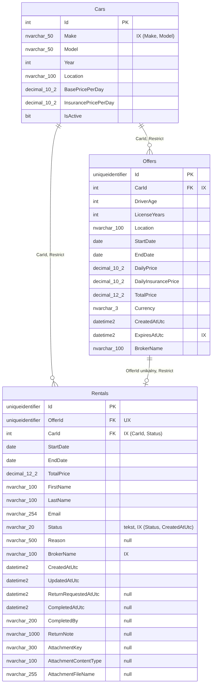
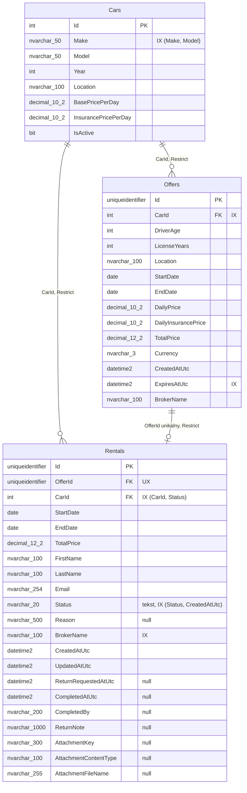
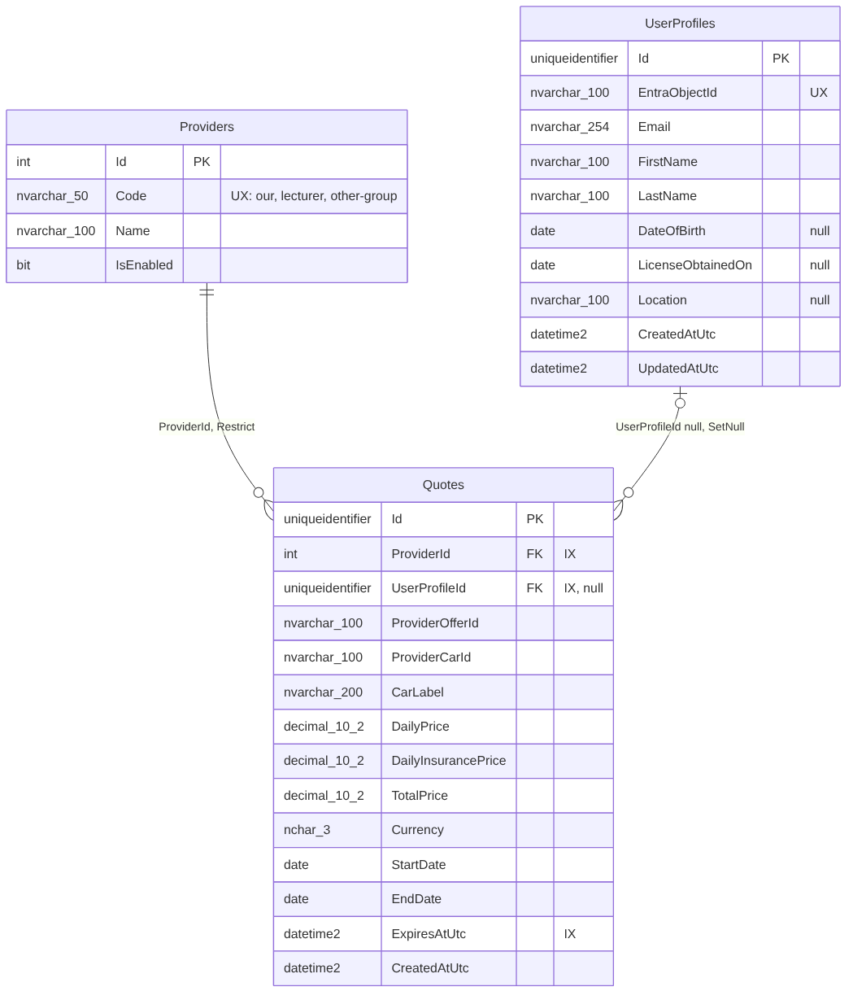
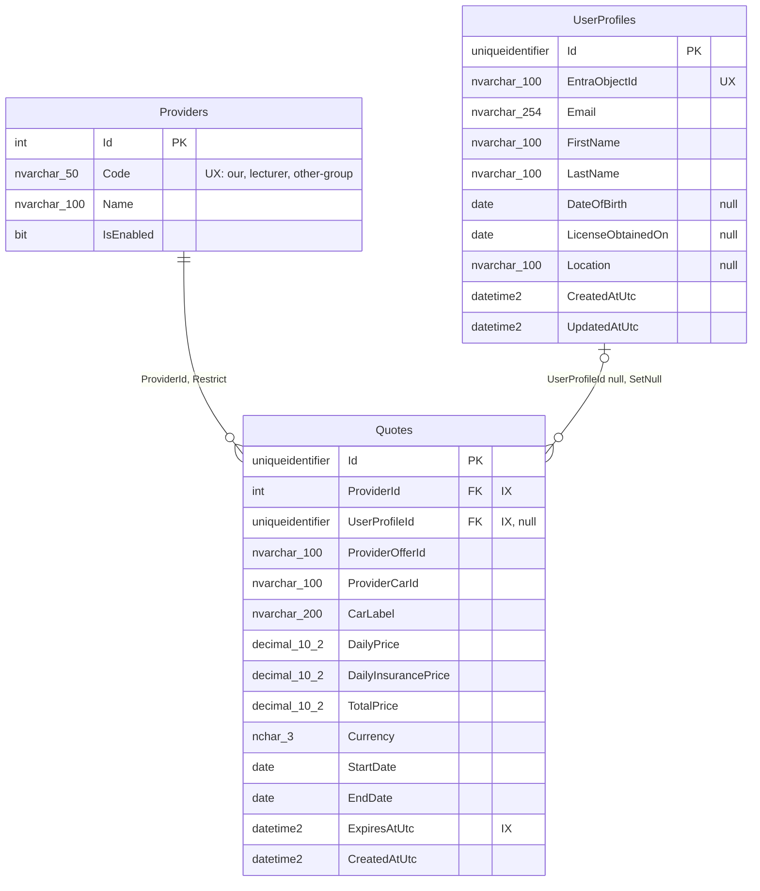

# Diagram ER (KM2)

Dwie osobne bazy: CarRental DB (nasza wypożyczalnia, Car Rental API) i Broker DB (aplikacja pośrednicząca). Schemat ma powstawać z migracji EF (`InitialCreate`, generuje ją Maks skryptem `scripts/add-migrations.ps1`), a diagram zrobiłem z konfiguracji EF w kodzie. Konfiguracja jest tylko fluent w `Data/Configurations`. Oznaczenia: PK klucz główny, FK klucz obcy, IX indeks, UX indeks unikalny, null kolumna opcjonalna. Źródła: `docs/diagrams/er-*.mmd`.

## CarRental DB (sqldb-carrental)

- Seed: 12 aut (`HasData`, jest w migracji).
- Oferta należy do jednego auta, wynajem powstaje z jednej oferty (unikalny OfferId), więc jednej oferty nie da się wynająć dwa razy.
- Rental kopiuje CarId, daty i cenę z oferty. To celowy zapis warunków z chwili wynajmu.
- Klucze obce mają Restrict: auta z ofertami nie usuwamy, wycofujemy je flagą IsActive.
- Status wynajmu jest zapisany jako tekst (Pending, Confirmed, Rejected, ReturnRequested, Completed).
- Indeksy pod zapytania: (Make, Model) katalog, (CarId, Status) dostępność auta, (Status, CreatedAtUtc) proces w tle i panel pracownika, BrokerName izolacja brokerów, ExpiresAtUtc sprzątanie ofert.

## Broker DB (sqldb-broker)

- Seed: 3 wypożyczalnie (our włączona, lecturer i other-group wyłączone do KM3). Adresy i klucze API nie są w bazie, tylko w konfiguracji.
- Profil trzyma daty (urodzenia, prawa jazdy), a nie wiek i staż. Wiek i staż liczymy na dzień wyceny.
- Quotes to oferty pokazane użytkownikowi. Usunięcie profilu nie usuwa ofert (SetNull), wypożyczalni z ofertami nie da się usunąć (Restrict).
- Indeksy: unikalny EntraObjectId (profil szukany po oid z tokena), unikalny Code, Quotes(UserProfileId) i Quotes(ExpiresAtUtc) do sprzątania w tle.
